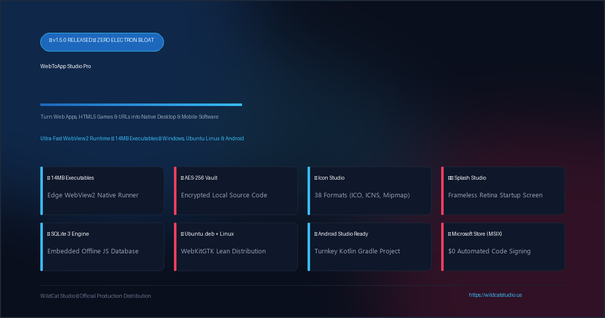

# WildCat Studio

**Independent software engineering, developer tools and online games.**

[](https://wildcatstudio.us/)
[](https://github.com/djacidfx/webtoapp-releases/releases/latest)
[](https://wildcatstudio.us/proxalume/)
[](https://wildcatstudio.us/vanguard-front/)

Welcome to the official WildCat Studio website repository. This repository maintains our public product showcases, technical documentation, release discovery and community resources. WildCat Studio brings together practical development software, software intelligence and independent game development, with an emphasis on performance, usability, maintainability and responsible release engineering.

**[Visit the official website](https://wildcatstudio.us/)** · **[Explore featured projects](https://wildcatstudio.us/#featured-projects)**

## Project portfolio

| Project | Purpose | Platforms and availability |
| --- | --- | --- |
| **WebToApp Studio Pro** | Native application packaging and developer toolchain for existing web applications | Windows and Linux desktop tooling; Windows, Linux and Android packaging targets. Public releases available. |
| **Proxalume Studio** | Software intelligence, architecture visualization, binary inspection and forensic workflows | Windows and Linux desktop targets with a dedicated commercial web platform. Consult the official product site for release availability. |
| **Vanguard Front** | Persistent multiplayer space strategy and empire management | Browser-based online game; current universe availability and rules are provided by the official game. |

## WebToApp Studio Pro

[](https://wildcatstudio.us/)

WebToApp Studio Pro is a packaging and compilation suite that turns existing websites, HTML5 games and client-side web applications into native desktop packages and Android Studio projects. Rather than replacing a developer's preferred web framework, it provides a deployment toolchain built around platform-native web runtimes.

### Capabilities

- Windows packaging using Microsoft Edge WebView2, with standalone and lightweight distribution options.
- Linux packaging using WebKitGTK, including Debian packages and portable archives.
- Android Studio project generation for mobile distribution.
- Integrated Icon Studio, Splash Studio and PWA tooling.
- Native SQLite bridge, virtual HTTPS hosting and configurable navigation controls.
- AES-256 asset protection, custom deep links and installer-script generation.
- Multi-platform builds, release checksums and linked malware-scan reports.

The website includes interactive application demonstrations, icon and splash-screen playgrounds, architecture comparisons, a development roadmap, release downloads and an extensive FAQ. Release requirements and integrity records are provided alongside the respective packages; security scans are not a guarantee of absolute safety.

| Resource | Link |
| --- | --- |
| Product website | [WebToApp Studio Pro](https://wildcatstudio.us/) |
| Downloads and verification | [Download center](https://wildcatstudio.us/#downloads) |
| Public release repository | [webtoapp-releases](https://github.com/djacidfx/webtoapp-releases) |
| Latest published release | [GitHub Releases](https://github.com/djacidfx/webtoapp-releases/releases/latest) |
| User documentation | [Documentation hub](https://wildcatstudio.us/docs/) |
| Windows Store publishing | [MSIX submission guide](https://wildcatstudio.us/docs/microsoft-store-guide.html) |
| Android publishing | [Google Play guide](https://wildcatstudio.us/docs/google-play-guide.html) |
| Technical reference | [Project wiki](https://github.com/djacidfx/webtoapp-releases/wiki) |
| Support and feature requests | [Issue tracker](https://github.com/djacidfx/webtoapp-releases/issues) |

## Proxalume Studio

*See the whole system. Understand every layer.*

Proxalume Studio is a local-first software intelligence workbench for developers, architects, security reviewers and digital forensic investigators. It combines source-code relationships, static binary inspection and evidence-oriented workflows in a C#/.NET desktop application with an Avalonia interface.

### Capabilities

- Multi-language source analysis, symbols, dependencies and call relationships.
- Interactive 2D relationship graphs and 3D Code City architecture visualization.
- Laravel route, controller, model and database relationship analysis.
- Snapshot comparison, change-impact review and project-health findings.
- Binary Workbench for supported executable and firmware formats, disassembly, control flow and approximate native pseudo-C recovery.
- Dependency inventory, CycloneDX SBOM export and supported provenance checks.
- Supported forensic artifacts, rule evaluation and tamper-evident evidence exports.

The separate commercial platform is designed around licensing, activation, customer accounts, organizations and seat management. Core static inspection is designed for local operation; activation and selected online services require connectivity. Analysis results and recovered code must be evaluated in context, and coverage varies by input format and architecture.

Windows and Linux packages are planned or verified according to individual release gates. The studio showcase documents the project and its development status; it is not a distribution mirror or an announcement of production approval.

| Resource | Link |
| --- | --- |
| Studio showcase | [Proxalume Studio](https://wildcatstudio.us/proxalume/) |
| Technical documentation | [Proxalume documentation](https://wildcatstudio.us/proxalume/documentation/) |
| Official product site | [proxalume.com](https://proxalume.com/) |

## Vanguard Front

*Deployment Protocol. Command your own frontier.*

Vanguard Front is an independent persistent, real-time multiplayer space strategy game set in the Meridian Reach. Players establish a homeworld, develop an industrial economy, research technologies, build fleets and negotiate alliances in a shared online universe.

### Gameplay systems

- Colony infrastructure, resource extraction, energy management and storage.
- Research, technology progression, shipyards and fleet specialization.
- Exploration, colonization, transport, espionage and fleet operations.
- Planetary defenses, tactical combat and salvage mechanics.
- Alliance coordination, diplomacy and joint operations.
- Three documented strategic doctrines centered on industry, warfare and exploration.

The setting describes 499 star systems surrounding Meridian Zero, with a history shaped by the collapse of an ancient gate network. The browser-based game uses a Laravel web application; its published field manual explains the setting, mechanics and commander workflows. Live universe settings, features and balance remain subject to the official game.

| Resource | Link |
| --- | --- |
| Studio showcase | [Vanguard Front](https://wildcatstudio.us/vanguard-front/) |
| Player documentation | [Commander's tactical field manual](https://wildcatstudio.us/vanguard-front/documentation/) |
| Official game | [vanguardfront.online](https://vanguardfront.online/) |

## About the website

The public portal is a lightweight, static website built with semantic HTML, CSS and vanilla JavaScript. It provides responsive project showcases, light and dark themes, interactive product demonstrations, accessible navigation and search-friendly canonical URLs.

### Repository structure

```text
wildcatstudio.us/
├── index.html                    # Main portal and WebToApp product page
├── README.md                     # Repository and project portfolio overview
├── 404.html                      # Branded error page
├── CNAME                         # Custom domain
├── robots.txt                    # Crawler directives and sitemap discovery
├── sitemap.xml                   # Canonical public page URLs
├── css/
│   ├── style.css                 # Shared visual system and responsive layout
│   ├── featured-projects.css     # Homepage portfolio cards
│   ├── proxalume.css             # Proxalume showcase styling
│   └── vanguard.css              # Vanguard Front styling
├── js/
│   ├── main.js                   # Product demos and homepage interactions
│   └── clean-url.js              # Public URL normalization
├── docs/                         # WebToApp documentation and store guides
├── proxalume/
│   ├── index.html                # Software intelligence showcase
│   └── documentation/            # Technical documentation
├── vanguard-front/
│   ├── index.html                # Game showcase
│   └── documentation/            # Commander's field manual
└── *.png                         # Brand artwork and social previews
```

This repository contains the public website and its documentation, not the complete source code or distribution packages of each product. Refer to the linked product resources for their respective terms, releases and support channels.

### Local preview

From the repository root, serve the static files using a local HTTP server. No package installation or frontend build is required for this preview.

```bash
git clone https://github.com/djacidfx/wildcatstudio.us.git
cd wildcatstudio.us
python3 -m http.server 8000
```

Open `http://localhost:8000/` in a browser. Serving from the repository root ensures root-relative paths and directory-based navigation work correctly.

### Hosting and publishing

| Component | Configuration |
| --- | --- |
| Hosting | GitHub Pages |
| Production domain | `wildcatstudio.us` |
| Transport | HTTPS |
| Frontend | HTML, CSS and JavaScript |
| Search discovery | [XML sitemap](https://wildcatstudio.us/sitemap.xml) and [robots.txt](https://wildcatstudio.us/robots.txt) |
| Product distribution | Dedicated public release and product channels |

When maintaining the website, preserve existing public URLs and canonical tags, verify internal links and assets, test mobile and desktop layouts in both color themes, and update sitemap modification dates when page content changes. Keep product availability and version-specific claims aligned with their official release information.

## Studio background

WildCat Studio and its software ecosystem grew from more than two years of internal research, engineering and iterative development, as documented in the original project overview. Continued modernization has focused on supported runtimes, interface quality, security hardening, verification and documentation. The public portfolio brings these projects together while preserving their distinct identities and distribution channels.

## Support and community

For WebToApp bugs or feature requests, use the [public issue tracker](https://github.com/djacidfx/webtoapp-releases/issues). For Proxalume or Vanguard Front, use the support resources on their respective official sites.

If you would like to support independent development, visit [WildCat Studio on Buy Me a Coffee](https://buymeacoffee.com/wildcatstudio).

---

© 2026 WildCat Studio. All rights reserved. Product names, artwork and documentation are subject to their applicable terms. No additional software or source-code license is implied by this overview.
